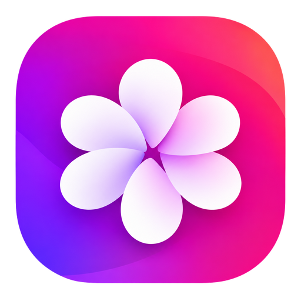

<p align="center">
  
</p>

<h1 align="center">YS Gallery</h1>

<p align="center">
  <strong>A fast, private gallery and photo editor for Android.</strong><br>
  Offline by design. One UI styling. No account, no ads, no tracking.
</p>

<p align="center">
  <a href="https://github.com/yeasin0423/YSGallery/releases/latest"></a>
  <a href="https://github.com/yeasin0423/YSGallery/actions/workflows/build-release.yml"></a>
  
  
  
</p>

<p align="center">
  <a href="https://github.com/yeasin0423/YSGallery/releases/latest"></a>
</p>

---

YS Gallery is a personal fork of Prism Gallery, rebuilt
around a full photo editor and trimmed to one design language (Samsung One UI) and one language
(English). It browses photos, videos and GIFs from internal storage and the SD card, and edits photos
without ever leaving the device.

The app ships **without the internet permission**, so nothing can be uploaded, logged or collected.
Settings, thumbnails and edits stay in local storage.

## At a glance

| Property | Support |
| --- | --- |
| Android | 10+ (API 29) |
| Media | Photos, videos, GIFs (editing is photos only) |
| Storage | Internal storage and SD card |
| Editor | Crop, adjust, filters, bokeh, draw, text, frames |
| Designs | Samsung One UI only |
| Languages | English only |
| Permissions | Photo/video access only; no network |
| Artifact | Release APK built by CI |

## Features

| | |
| --- | --- |
| **One UI look** | AMOLED-friendly dark and light palettes, grouped cards, floating frosted bars, compact titles and smooth page transitions. |
| **Library** | Photos, videos and GIFs from internal storage and the SD card, with adjustable deep zoom that keeps huge photos and long screenshots readable. |
| **Albums** | Create, rename, hide and nest albums; move media or whole albums between storage volumes. |
| **Keep or clear** | Favorites and a trash you can empty from Settings. |
| **Storage overview** | Free and used space for internal storage and the SD card, with per-category breakdowns. |
| **Open with** | Receives photos and videos from other apps, like the system gallery. |
| **Older devices** | Adjustable graphics-quality tiers for low-memory or older phones. |
| **Private by default** | No internet permission, no analytics, no crash reporting, no account. |

## The editor

The editor opens from any photo; videos and GIFs are intentionally not editable yet. It works in
five tabs:

| Tab | What it does |
| --- | --- |
| **Crop** | Free or fixed ratios, quarter-turn rotation either way, mirror horizontally or vertically. |
| **Adjust** | Brightness, contrast, saturation, warmth, tint, black point, white point and highlights. |
| **Filters** | 27 live presets, including retro film and tape looks; five bokeh light styles; ten frames. Filters, Frames and Bokeh are separate sections of the tab. |
| **Draw** | Brush, eraser, blur brush and mosaic brush, one width slider, stroke or circular patch shapes. Mosaic paints hard square blocks, not blur. |
| **Text** | Multiple draggable, resizable and rotatable labels in twenty font styles, including outline, neon and shadow effects, typed in a floating writing bar that rides above the keyboard. |

Everything else the editor needs is there too: undo, redo and reset; a before/after button above the
photo (tap for a draggable split, hold to peek at the original); pinch zoom and pan; a live ring for
the brush, eraser, blur and mosaic size; and a confirmation when closing with unsaved edits. Edits are
saved as a copy by default, with a confirmed overwrite of the original as the alternative.

The live preview and the exported file run the same pipeline in the same order: mirror, rotate, crop,
colour matrix, blur and mosaic patches, bokeh, ink, labels, then the frame. What you see is what gets
saved.

## Privacy

YS Gallery has no internet permission, so it cannot send anything anywhere. It only asks for access to
your photos and videos. Albums, settings and edits are stored on the device.

## Download

Signed builds are published on the [releases page](https://github.com/yeasin0423/YSGallery/releases).

## Build from source

Requirements: JDK 17 or newer and the Android SDK (compile SDK 34).

```sh
./gradlew assembleRelease
```

The APK is written to `app/build/outputs/apk/release/`. To sign your own build, create a git-ignored
`keystore.properties` in the project root:

```properties
storeFile=/path/to/your-release-key.jks
storePassword=...
keyAlias=...
keyPassword=...
```

### Gradle in CI

There are two **manual** workflows (`workflow_dispatch`); a normal push does not start a build:

- **Build release APK** – the normal build. It uses the Gradle wrapper (`./gradlew`), which downloads
  Gradle 8.9 from `https://services.gradle.org/distributions/gradle-8.9-bin.zip` and verifies its
  SHA-256 (`distributionSha256Sum` in `gradle/wrapper/gradle-wrapper.properties`).
- **Build release APK (mirror)** – the fallback for when services.gradle.org is down. It downloads the
  identical archive from this repository's `v2.7-b12` release, checks the same SHA-256 and runs that
  `gradle` directly.

Both upload the APK as an artifact. The Gradle archive is not stored in the repository; older
builds that committed it in three parts were purged from the history so clones stay small.

## Project layout

```text
app/src/main/java/com/gallery/app/   app shell, gallery, editor, design system
app/src/main/res/                    strings, themes, launcher icons
docs/                                README artwork and project documentation
fastlane/metadata/android/en-US/     store listing (English only)
gradle/wrapper/                      Gradle 8.9 wrapper
.github/workflows/                   manual release builds
```

Development rules for this fork live in [AGENTS.md](AGENTS.md).

## Credits

- [Prism Gallery](https://github.com/Soretake/PrismGallery) by Soretake — the upstream project this
  fork is based on.
- Samsung One UI — the visual language the interface follows.

## Disclaimer

YS Gallery is an independent project and is not affiliated with, endorsed by or connected to Samsung.
The One UI name is only used to describe the visual style the design is inspired by.
